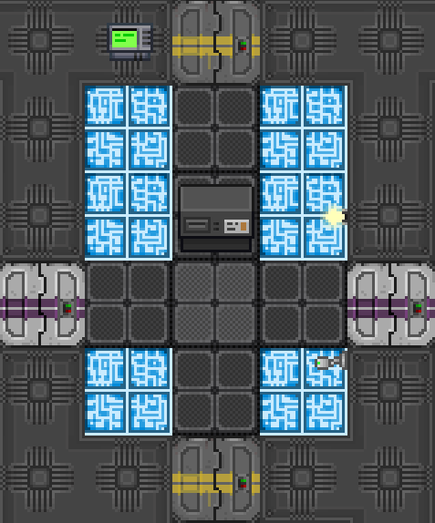
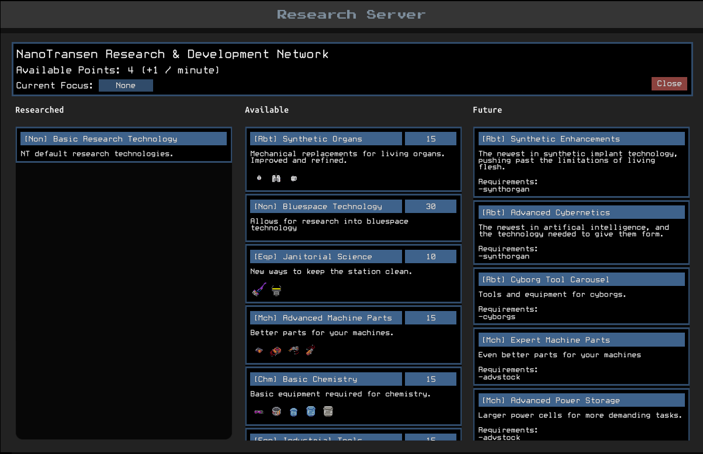
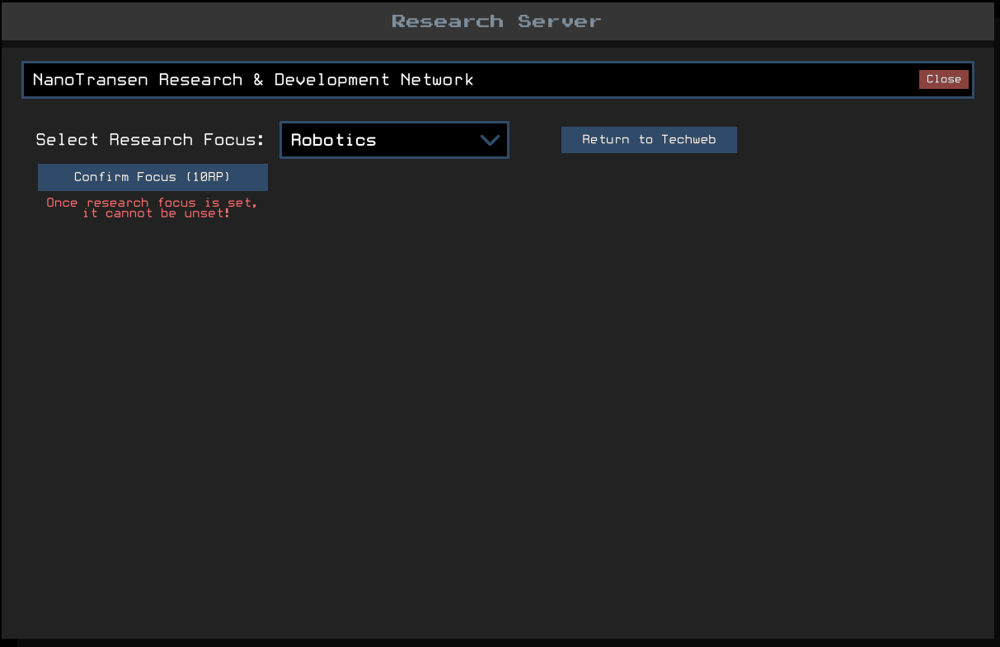

> 🔗 **Liens**
> - Page d'origine (MediaWiki) : https://wiki.unitystation.org/index.php/Guide_to_Research_and_Development
> - Fiche cible dans le dépôt : [docs/3_HowToPlay/Jobs/Science_roles/Scientist.md](https://github.com/Unitystation-fork/Unitystation-WikiV2/blob/main/docs/3_HowToPlay/Jobs/Science_roles/Scientist.md)
> - Fiche cible en ligne : https://unitystation-wiki.unionrolistes.fr/HowToPlay/Jobs/Science_roles/Scientist/
> - Suivi : [ticket de relecture](https://github.com/Unitystation-fork/Unitystation-WikiV2/issues/372)

# Fiche 01 : Guide to Research and Development

- **Source** : [Guide to Research and Development](https://wiki.unitystation.org/index.php/Guide_to_Research_and_Development)
- **Dernière modification** : 2025-05-05
- **Taille** : 921 mots (compte de l'inventaire)
- **Priorité** : haute (Science)

**Où la mettre**

Fiche métier : `docs/3_HowToPlay/Jobs/Science_roles/Scientist.md`. Section proposée : « Research and Development (Techweb) », avec sous-sections The Techweb, Technology Types and Research Focuses, List of Techweb Nodes, Tips and Tricks. C'est la page « mère » : les fiches 04, 05 et 06 y sont rattachées (elles donnent les points de recherche).

**Ce qui existe déjà dans le wiki**

Rien sur le techweb, les points de recherche (RP), le serveur de recherche ni le « research focus » dans `docs/`. Le protolathe n'est cité qu'en passant (`docs/3_HowToPlay/Jobs/Science_roles/XenoBiologist.md`) pour fabriquer des disques de données). `Scientist.md` (40 mots) et `Research-Director.md` (60 mots) ne contiennent que l'avertissement « SCIENCE ROLES CURRENTLY CAN NOT DO ANYTHING ».

**À vérifier**

- La liste des nœuds du techweb est marquée par l'auteur « outdated, need to be updated » : coûts et contenus à contrôler en jeu, ou à ne pas reprendre.
- Coût du « research focus » : 10 RP, réduction de 25 %, une seule fois. Le même chiffre est répété dans la fiche 03 (Research Director) : garder une seule version.
- Modèle `TechwebNode` retiré : ses 4 paramètres (nom, déblocages, type, coût en RP) sont rendus en tableau.
- Images manquantes : ServerRoom.png, TechwebUI.png, FocusUI.png.
- Le lien vers « Guide to Xenobiology » pointe vers une page qui n'est pas dans le lot extrait (aucun guide de xénobiologie dans le dossier à convertir ni dans `docs/`).
- Raccourci de la page : « Roles Footer » et catégorie « Research Guides » retirés (ancien wiki).

**Décision**

- [ ] copier tel quel
- [ ] réécrire
- [ ] fusionner dans `Scientist.md`, chapitre « Research and Development (Techweb) »
- [ ] abandonner

---

**Contenu converti en Markdown (anglais, non réécrit)**

---

As a scientist, your primary role to the station is to provide new technologies to the station through the techweb. The techweb, in short, is a tech tree in which the science department can research new technologies for the cost of research points (RP). In unitystation, RP is earnt through physical experiments, divided into several subcategories:

- Xenoarchaeology, The study of artifacts and their effects (ancien lien : Guide to Xenoarcheology)

- Ordnance, The study of chemicals and explosives (ancien lien : Guide to Ordnance)

- The High Energy Lab, The study of high energy lasers (ancien lien : Guide to the High Energy Lab)

- Xenobiology, The study of slimes and their behaviours (ancien lien : Guide to Xenobiology)

## The Techweb

### The Techweb

The Techweb is the technology tree that you are tasked to research. It is stored and accessed through the stations research server inside the science department. The Techweb contains a series of nodes, that when researched, unlock *designs*. 

Designs are products that can be produced within machines such as the Protolathe, Circuit Imprinter and Exosuit Fabricator. Designs have a material cost, a required machine type and may have a required department. Once a design is researched, it can be manufactured at any valid machine that is connected to the research server. If the machine is not connected to the research server (often indicated by red lights beside a 'connected to server' label in the machines UI) it can be connected via a multitool. 

Example designs and their restrictions include Synthetic Lungs (Producible at an Exosuit Fabricator) or an Advanced Mop (Producable at a Science or Service Protolathe).
The Techweb is divided into three categories: Researched Tech, Available Tech & Future Tech. Researched tech encompasses all Tech web nodes that have already been researched on this Techweb. Available tech lists all tech that has not been researched but the prerequisites have been met. Available tech lists the technology type in square brackets [], the cost in RP to research the node, as well as the node description. The images in the description of the node visually show what will be unlocked for production once the node is researched. Not all nodes unlock new designs, some nodes, such as 'Bluespace Technology' simply serve as prerequisites for more advanced nodes further up on the Techweb. Future tech holds all technologies that the department does not yet meet the requirements for, the prerequisites for that node are listed in its description. 

### Technology Types & Research Focuses

For standard duration rounds, it is unlikely that the science department will be able to research the entire Techweb. As such a science department might choose to focus on one type of technology over another. In Unitystation, technology is split into several categories:  

Machinery [Mch] - Focusing on machine parts and circuit boards,  

Robotics [Rbt] - Focusing on cyborgs and synthetic implants,  

Chemistry [Chm] - Focusing on matter and chemical storage as well as other chemistry materials  

Equipment [Eqp] - Focusing on gear and tools applicable across the station.  

The category a node belongs to is stated in its title in square brackets []. If a science department wishes to focus there efforts to a particular category, the research director, or anyone with research director access, may allocate a research focus in the Techweb UI. Allocating a focus costs 10 RP and *can only be done once.* Once a focus is selected, all technology in that category will receive a 25% discount. 

### List of Techweb Nodes

*These nodes are outdated and need to be updated to match the current techweb*

| Node | Unlocks | Type | Cost (RP) |
|---|---|---|---|
| Synthetic Organs | Synthetic Lungs, Synthetic Heart, Synthetic Liver | Robotics | 15 |
| Synthetic Enhancements | Breathing Tube Implant, Reviver Implant, Welding Shield Implant | Robotics | 30 |
| Advanced Cybernetics | All Cyborg limbs, Man-Machine Interface, Positronic Brain, Cyborg Light Implant, Battery Pack | Robotics | 30 |
| Cyborg Tools | Janitor Tool Carousel, Engineering Tool Carousel, Medical Tool Carousel | Robotics | 25 |
| Bluespace Technology | None | None | 30 |
| Janitorial Science | Advanced Mop, Advanced Light Replacer | Equipment | 10 |
| Industrial Tools | Welding Mask, Jaws of Life, Mag Boots | Equipment | 15 |
| Anomaly Science | AP Hardsuit, Anomaly Suit, Hand Pick, Sample Container, Artifact Data Disk | Equipment | 30 |
| Mining Technology | Mining Hardsuit, Drill, Diamond Drill, Plasma Cutter, Advanced Plasma Cutter | Equipment | 40 |
| Bluespace Holding | Bag of Holding, Satchel of Holding, Trash Bag od Holding | Equipment | 50 |
| Advanced Machine Parts | Advanced Capacitor, Advanced Scanning Module, Nano Manipulator, High Power Micro Laser | Machinery | 15 |
| Expert Machine Parts | Super Capacitor, Phasic Scannign Module, Pico Manipulator, Ultra Micro Laser, Quadratic Capacitor, Triphasic Scanning Module, Femto Manipulator, Quadultra Micro Laser | Machinery | 45 |
| Advanced Power Storage | Hyper Capacity Powercell, Bluespace Powercell | Machinery | 30 |
| Basic Chemistry | Science Goggles, Advanced Matter Bin, Beaker, Large Beaker, XL Beaker | Chemistry | 15 |
| Meta Material Storage | Meta Material Beaker, Super Matter Bin | Chemistry | 30 |
| Bluespace Storage | Bluespace Beaker, Bluespace Matter Bin | Chemistry | 30 |

## Tips & Tricks

* Using your first 10RP each round to set a research focus can drastically speed up research time in future, don't forget it as part of the round start setup, **especially** if you are the stations research director.
* Xenoarchaeology can yield large quantities of RP, upwards of 30RP per artifact, however, can only be conducted when the science department has an artifact. Conversely, Ordnance and The High Energy Lab require no outside materials to run but tend to have lower yields for time investment. Make the best use of all of them to maximise RP!
* If your science department contains multiple scientists, split them up amongst each of the areas of research, more scientists researching the same thing doesn't always make it go quicker!
* While you should be busy researching, don't neglect customer service! Make sure you are still supplying the station with your discoveries and listening to requests from peers.
