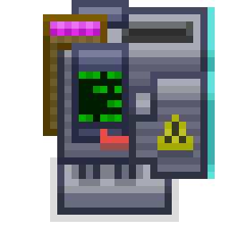
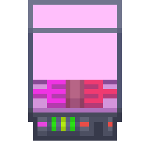
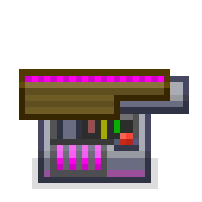
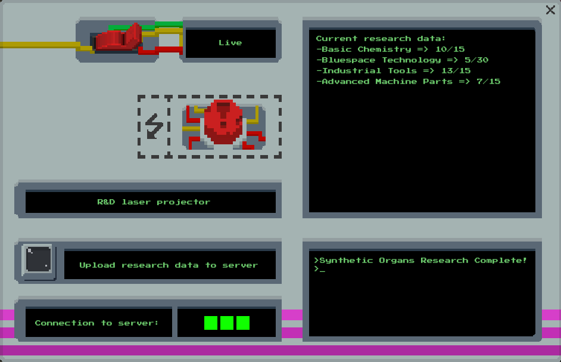
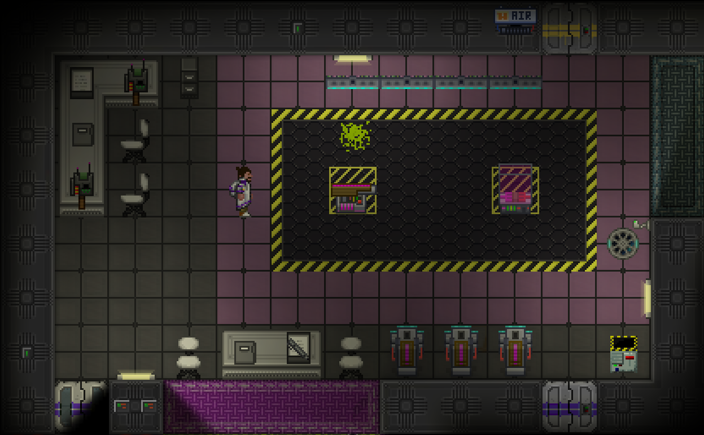

> 🔗 **Liens**
> - Page d'origine (MediaWiki) : https://wiki.unitystation.org/index.php/Guide_to_the_High_Energy_Lab
> - Fiche cible dans le dépôt : [docs/3_HowToPlay/Jobs/Science_roles/Scientist.md](https://github.com/Unitystation-fork/Unitystation-WikiV2/blob/main/docs/3_HowToPlay/Jobs/Science_roles/Scientist.md)
> - Fiche cible en ligne : https://unitystation-wiki.unionrolistes.fr/HowToPlay/Jobs/Science_roles/Scientist/
> - Suivi : [ticket de relecture](https://github.com/Unitystation-fork/Unitystation-WikiV2/issues/372)

> ⚠️ **Vérifié dans le code du jeu (26/10)** : « H.I.E.C.A » n'existe nulle part ; le projecteur laser de recherche existe (`Systems/Research/LaserPuzzle/ResearchLaserProjector.cs`). Une partie de cette page est donc peut-être périmée.

# Fiche 05 : Guide to the High Energy Lab

- **Source** : [Guide to the High Energy Lab](https://wiki.unitystation.org/index.php/Guide_to_the_High_Energy_Lab)
- **Dernière modification** : 2025-05-05
- **Taille** : 1155 mots (compte de l'inventaire)
- **Priorité** : haute (Science)

**Où la mettre**

Fiche métier : `docs/3_HowToPlay/Jobs/Science_roles/Scientist.md`, chapitre « The High Energy Lab ». Sections : Objects of the High Energy Lab (H.I.E.C.A, Research Item Plinth, R&D Laser Projector), Research Objects, Resonance Cascades, Tips and Tricks.

**Ce qui existe déjà dans le wiki**

Aucune occurrence de H.I.E.C.A ni du projecteur laser R&D dans `docs/`. Le laser n'est cité qu'en tant qu'arme dans d'autres pages. Rien sur les « resonance cascades ».

**À vérifier**

- Fonctionnement très technique (modes Visual et Live, 75 % d'efficacité en convertissant les données en RP, plus de 10 lignes de dispersion = risque de cascade) : à valider en jeu.
- Le projecteur se branche sur un câble moyenne tension en recouvrement, pas sur un APC (à vérifier avec `docs/5_Dev/Introduction/development/Electricity-Development.md`).
- La section « Mapping » en fin de page s'adresse aux développeurs et mappeurs, pas aux joueurs : à déplacer dans `docs/5_Dev/Introduction/development/How-to-Map.md` (ou à supprimer), pas dans la fiche métier. Ici : liste de 5 points avec noms internes (`ResearchPlinth`, `EnergyCollector`, `ResearchItemScanner`, `ReflectorSingle`).
- Images manquantes : Research laser collector sprite.png, Research item plinth.png, Research laser emitter.png, RnD Laser Projector UI.png, MinistationHEL.png.
- La section « Image References » ne contenait qu'une image : elle disparaît à la conversion.

**Décision**

- [ ] copier tel quel
- [ ] réécrire
- [ ] fusionner dans `Scientist.md`, chapitre « The High Energy Lab »
- [ ] abandonner

---

**Contenu converti en Markdown (anglais, non réécrit)**

---

If your dream method of conducting science is to repeatedly destroy objects with high energy laser bolts in the vain hope of learning something new then your local stations High Energy Lab is the place for you!

## Objects of the High Energy Lab

### The H.I.E.C.A

The H.I.E.C.A or High intensity energy collection apparatus is the machine used to collect the data from scattered laser bolts emitted from the R&D Laser Projector. In order to function correctly, the H.I.E.C.A must be first connected to an APC and the laser projector it is intended to send data too. This can be done by using a multitool on the master APC or Laser Projector and then using the multitool on the desired H.I.E.C.A. The H.I.E.C.A must be secured to the floor via a wrench. Once secure, the H.I.E.C.A may be rotated by simply interacting with it using an open hand. When a scattered laser bolt hits the H.I.E.C.A's collector (The blue face), the data will be automatically transferred to the projector.

### The Research Item Plinth

The research item plinth is used to contain objects in stasis, ready to be shot by the R&D laser projector. An item may not be shot with the research laser unless it is being held in stasis within an item plinth. All scattered shots will originate from the plinth on contact. It should be noted that the item plinth contains an inbuilt security measure that will refuse crew members attempting to place high risk items such as the nuclear disk or the captain's hat inside of it, as such, it cannot be used to dispose of such items.

### The R&D Laser Projector

The R&D Laser Projector is your workhorse in the high energy lab. The R&D laser projector can be used to fire specialised high energy laser projectiles, which upon colliding with any item held within a research item plinth, will scatter with varying energy and velocity. The scattered laser bolts can be collected via H.I.E.C.A panels, providing invaluable data towards research nodes. The projector has two modes: Visual and Live.  

While in visual mode, pressing the power button will project the visual path of the laser to be shot, including the paths of any scattered bolts if the path intercepts a research item plinth. While in live mode, the visual path will not be visible and pressing the power button will instead fire a high energy laser projectile. 

Once a laser bolt intercepts a H.I.E.C.A panel, the research data will be automatically transferred to the projector, this data can be viewed in the "Current Research Data" section of the UI. Research data is in the form of progress towards an unresearched Techweb node. Once enough research data for a specific Techweb node is completed, the Techweb node will be researched. Operators of the laser projector have no control as to what nodes are researched. If need be, players can sacrifice research data and upload it to the Techweb as RP to be redistributed towards any research node, however, uploading this data as RP is only 75% efficient and RP loss will occur. 

An R&D laser projector does not connect to an APC, but instead must be connected to a medium voltage cable using an overlap connection similar to a SMES or radiation collector.

## Research Objects

Every object has some research value that approximates the value of the data that might be obtained from it. This value can be measured using an R.I.E scanner, found in all high energy labs. More common objects such as oxygen masks, metal and tools tend to have lower research values while rarer items such as rare seed variants, clothing and ores tend to have higher research values. It should be noted that once an object has been researched, no more data can be obtained from the same object type.

## Resonance Cascades

Destroying material with high energy lasers does not come without its risks, disregarding the danger of a laser gun, the high energy collisions can sometimes cause run away anomalies to occur, known as resonance cascades. An unstable object will visually appear as any other high value item, upon placing it in the plinth and visualising the path, many scatter paths can be observed, here, you must be careful. While it very well might be just a high value research item, crew should be warned of the possibility of unstable objects. Upon being struck with a high energy laser shot, and unstable item will cause a resonance cascade, an explosive and anomalous event. A resonance cascade can result in structural damage or the materialisation of bizarre and abnormal creatures. An prospering scientist need be well aware of cascades and take care to avoid triggering one. 

## Tips & Tricks

* The R&D laser projector annihilates any object placed within the plinth. While this does not work for high risk items, it can still be used as an effective method for disposing trash or removing evidence without arising cargo's knowledge.
* The R&D laser projector respects the selected research focus, ensure to set the departments focus before starting to maximise efficiency. 
* Toolboxes and other containers are a good source of test items, as not only to they contain a variety of items, but they themselves can be used for effective research. 
* If you are gathering large quantities of items, ensure to scan the quality of items so you do not waste time researching items for very little gain; Maximise your time efficiency. 
* When rotating a reflector panel, interacting normally with a screwdriver will rotate it clockwise, but interacting while holding the ALT key will rotate it anti-clockwise. 
* Between reflector panels and H.I.E.C.A's, you will be needing a variety of tools to consistently operate. Acquiring a toolbelt and/or toolbox will greatly speedup your research time. 
* Avoid shooting objects with greater than 10 scatter lines, while these might just be high value, they can often be unstable and the source of a resonance cascade. 

## Image References

## Mapping

If you are a developer planning on mapping a high energy lab, make sure you can tick all the following boxes:

- [ ] The department has at least one R&D laser projector and that this projector is correctly connected to power (Aswell as the department research server).

- [ ] The department has at least one Research Item Plinth. (In engine name: ResearchPlinth)

- [ ] The department has between 1-2 H.I.E.C.A's for each item plinth. Ensure the H.I.E.C.A's are correctly connected to power and the projector. (In engine name: EnergyCollector)

- [ ] The department contains at least 2 R.I.E scanners, explore having more for larger maps. (In engine name: ResearchItemScanner)

- [ ] The department contains between 3-4 reflectors (In engine name: ReflectorSingle)
