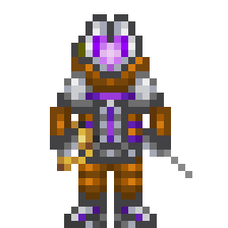
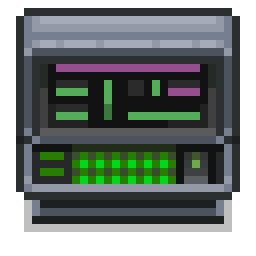
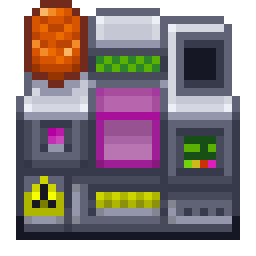

> 🔗 **Liens**
> - Page d'origine (MediaWiki) : https://wiki.unitystation.org/index.php/Guide_to_Xenoarcheology
> - Fiche cible dans le dépôt : [docs/3_HowToPlay/Jobs/Science_roles/XenoBiologist.md](https://github.com/Unitystation-fork/Unitystation-WikiV2/blob/main/docs/3_HowToPlay/Jobs/Science_roles/XenoBiologist.md)
> - Fiche cible en ligne : https://unitystation-wiki.unionrolistes.fr/HowToPlay/Jobs/Science_roles/XenoBiologist/
> - Suivi : [ticket de relecture](https://github.com/Unitystation-fork/Unitystation-WikiV2/issues/372)

> ✅ **Vérifié dans le code du jeu (26/10)** : les artefacts existent (`Objects/Research/Artifacts/`) et se vendent au cargo sous forme de **rapports d'anomalie papier** (`CargoManager.ResearchReports.cs`), comme le dit cette fiche, et pas sous forme de disques de données comme la page actuelle. Cette version de 2025 est donc la plus juste. Le mot « xenoarcheology » n'est pas employé dans le code.

# Fiche 06 : Guide to Xenoarcheology

- **Source** : [Guide to Xenoarcheology](https://wiki.unitystation.org/index.php/Guide_to_Xenoarcheology)
- **Dernière modification** : 2025-05-05
- **Taille** : 1257 mots (compte de l'inventaire)
- **Priorité** : haute (Science)

**Où la mettre**

Fiche métier : `docs/3_HowToPlay/Jobs/Science_roles/XenoBiologist.md` (la page est titrée « Xenoarcheology » dans le texte alors que le fichier s'appelle XenoBiologist). C'est une mise à jour, pas un ajout : remplacer les sections « Machines » et « Xenoarcheology Items » et ajouter « Mapping » (voir à vérifier).

**Ce qui existe déjà dans le wiki**

`XenoBiologist.md` contient déjà une version plus ancienne du même guide (97 % de ressemblance sur les titres, 80 % sur le texte). Différences : la console s'appelle ici « Anomaly Reporting Console » (rapport imprimé sur papier, 12 500 crédits) alors que la page actuelle décrit une « Artifact Research Console » avec disque de données (10 000 crédits) et une section « Artifact Data Disk ». Les sections Dormancy, Composition, Samples, AP Hardsuit, Anomaly Suit sont identiques.

**À vérifier**

- Conflit à trancher : console + disque de données (page actuelle) ou console + rapport imprimé (ancien wiki 2025). Le plus récent est probablement celui de la fiche, mais à confirmer en jeu.
- Montants : 12 500 crédits (rapport parfait), protection 90 % (AP hardsuit), 99 % (combinaison d'anomalie), 100 % (hardsuit du RD, cf. fiche 03).
- La section « Mapping » en fin de page s'adresse aux développeurs et mappeurs, pas aux joueurs : à déplacer dans `docs/5_Dev/Introduction/development/How-to-Map.md` (ou à supprimer), pas dans la fiche métier. Ici : 7 points.
- Images manquantes : Xenoarcheology_Wiki.png, Artifact Research Console.png, Artifact Analyzer.png, et 6 icônes du tableau des types d'artefacts (Ano00, Ano120, Ano90, Pick hand, Surgery scalpel, Tools welder).
- Le texte contient des fautes d'origine (« Nanotransen », « archeology »), conservées.

**Décision**

- [ ] copier tel quel
- [ ] réécrire
- [ ] fusionner dans `XenoBiologist.md` (mise à jour des sections Machines et Items)
- [ ] abandonner

---

**Contenu converti en Markdown (anglais, non réécrit)**

---

Do you wish to join Nanotransen's Scientists (ancien lien : Scientist) in their effort to study and collect alien artifacts? Welcome to Xenoarcheology! This guide will cover; Artifacts, Artifact Sampling, Xenoarcheology Machines, Xenoarcheology Items, Tips and tricks, Mapping.

## Machines

### Anomaly Reporting Console

The anomaly reporting is where you will be recording all your observations about artifacts you are studying. To connect the console to an artifact, use a multitool on your desired artifact, and then use the same multitool on the console, if done correctly, the artifacts ID shall appear in the consoles UI. In order to save your data, press the print button and the consoles current data will be printed to a physical anomaly report paper. The report with the recorded data can be sold at cargo, a flawless report will award 12,500 credits, mistakes will lower the report's value. Once a report about an artifact has been sold, subsequent reports will be worth 0 credits.

### Artifact Analyzer

The artifact analyzer is one of the most useful tools you have at your disposal to analyze artifacts. The analyzer can scan and deconstruct samples taken from artifacts. These scans not only provide useful data about the artifacts being study but also provide a small RP reward to its connected research server. Deconstructing samples provides materials from the samples internal composition, this can become a reliable if minor source of rare materials such as bluespace, uranium and bananium sheets.

## Artifacts

Artifacts are strange objects found in the depths on space in the hearts of asteroids and the plains of lavaland. All artifacts posses effects, both positive and negative that effect their environment in a number of ways. It's your job as a scientist to study these objects and find out what their effects are.

### Dormancy

All Artifacts begin in a dormant state. While in this dormant state their effects on the world are greatly reduced, dormant artifacts are relatively safe to transport and be near. When an artifact is interacted with or it suffers damage, It has a chance to wake up. This process can be stream lined by catalyzing the artifact with a Uranium Sheet. Once an artifact is awake it's full power is unleashed for better or for worse. If the science department has found itself in possession of a dangerous artifact that they wish to store, artifacts can be returned to a dormant state by exposing them to an atmosphere of Nitrous Oxide (N2O). The higher the concentration the quicker the artifact will fall dormant. Taking samples can also wake up artifacts from their dormant state.

### Composition and Effects

All artifacts have an internal composition that is a combination of bluespace, uranium, bananium and a base element based on its type. An artifacts composition can be studied with the Artifact Analyzer, wether by scanning the artifact, or deconstructing it and observing the obtained materials. An artifacts composition influences it's likely hood of possessing certain effects.

Those with higher bluespace compositions are more likely to possess teleportation and summoning related effects.

Those with higher uranium compositions are more likely to possess transmutation and damaging effects.

Those with higher bananium compositions are more likely to possess physiological effects such as stuns and paranoia.

### Artifact Samples

All artifacts can have samples taken from them, samples can be analyzed or deconstructed in the artifact analyzer. It is wise to note that while samples take after their parent artifacts properties, their properties can tend to vary upwards of 10%. As such Nanotransen encourages the taking of multiple samples to obtain the most accurate results. The tool needed to sample an artifact varies with its type, observe the table below for more information:

| Type (Image) | Type (Name) | Tool |
|---|---|---|
| 🖼️ Ano00.png (image manquante) | Geological | 🖼️ Pick hand.png (image manquante) |
| 🖼️ Ano120.png (image manquante) | Organic | 🖼️ Surgery scalpel.png (image manquante) |
| 🖼️ Ano90.png (image manquante) | Mechanical | 🖼️ Tools welder.png (image manquante) |

## Xenoarcheology Items

### Sample Container

The sample container is storage item that can hold three small items. The container is heavily reinforced and resistant to explosives, fire and acid. Ideal for storing valuable artifacts somewhere safe.

### Anomaly Report

Anomaly reports are pieces of paper. Mechanically that's all they are. However, written on them is information pertaining to studied artifacts. You can use the Anomaly Reporting console to generate these reports for you or write them yourself if you are familliar with the format. Completed reports may be sold at cargo, a 100% accurate report sells for 12,500 credits. If a report pertaining to a given artifact is sold, any subsequent reports on the same artifact will be worth 0. Measure twice, cut once.

### AP Hardsuit

AP hardsuits are hardsuits designed to resist the effects of anomalies, they provide good radiation protection and great anomaly protection. Although they are not as good as anomaly suits when it comes to blocking effects, it is advised to swap to an anomaly suit when inside the station walls.

### Anomaly Suit

A suit specialised for anomaly research. The suit provides almost flawless protection from all artifact effects, this is the go to suit for artifact researchers.

## Tips & Tricks

* Remember, xenoarcheology is science's closest relation to the cargo department. On small stations it is cargo that provides xenoarcheology with its samples, and in return the researched artifacts provide a nice credit sum for cargo. As a result, make sure you have good relations with the cargo department so you don't get cut off of your specimen supply.
* If you are planning on storing an artifact, gas it into dormancy. Dormancy is a powerful tool, and dangerous and deadly artifacts should be dormant whenever they can be without disrupting research, less you come under fire by the crew for a series of anomaly related injuries.
* Practice taking multiple samples of an artifact, and using the collective data to make more informed guesses as to the true composition of the artifact, you only have one shot at selling the artifact data, so make sure it counts!
* Always wear your AP Hardsuit/Anomaly suit when dealing with artifacts, the AP hardsuit provides 90% resistance and the anomaly suit 99%. If you are a research director, your prototype hardsuit provides a full 100% resistance. You don't want to be caught without it.
* Artifacts react upon taking damage (including sample taking), and they do not possess much integrity, so make sure to look after your artifacts, otherwise you could lose valuable research.

## Mapping

If you are a developer planning on mapping a xenoarcheology department, make sure you can tick all the following boxes:

- [ ] The department has at least one artifact analyzer, if its a large station, 2.

- [ ] The department has at least one anomaly reporting console, if its a large station, 2.

- [ ] The department contains a folder, pen and paper. This paper may be in the form of incomplete research papers.

- [ ] The department contains one of each sampling tool as well as a multitool for artifact connection.

- [ ] The department has an air locked gas chamber with access to Nitrous Oxide for placing artifacts in hibernation. On large stations consider having a small atmos setup.

- [ ] The department has at least 2 AP Hardsuit SSU's and 2 Anomaly Suit lockers, consider adding more for larger stations.

- [ ] The department has at least 2 sample containers, consider more for larger stations.

- [ ] Large stations should have their own shuttle for xenoarcheology research.
