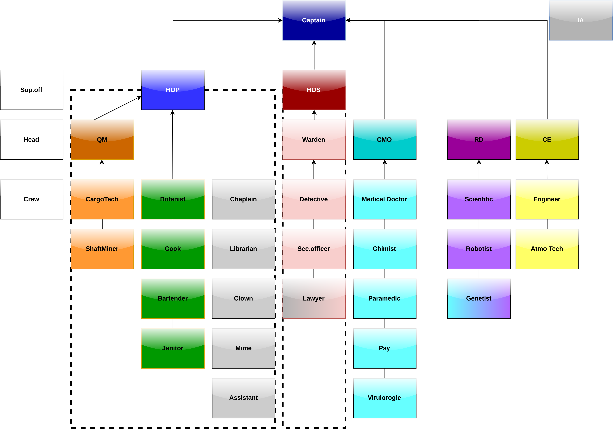

> 🔗 **Liens**
> - Source : schéma de Fr_Dae (`images/unitystation-hierarchie_1.png`)
> - Cible proposée : la page d'index des métiers, [docs/3_HowToPlay/Jobs/Jobs.md](https://github.com/Unitystation-fork/Unitystation-WikiV2/blob/main/docs/3_HowToPlay/Jobs/Jobs.md) (en ligne : https://unitystation-wiki.unionrolistes.fr/HowToPlay/Jobs/), juste sous le tableau des métiers

# Fiche 16 : hiérarchie de commandement

**À décider**
- [ ] mettre l'image telle quelle  - [ ] la refaire en schéma Mermaid (proposition ci-dessous)  - [ ] autre

**Pourquoi Mermaid** : le schéma est écrit en texte dans la page. Il est donc **traduisible** (les noms de métiers passent par les traductions), facile à mettre à jour (une ligne par lien), et il s'affiche en clair comme en sombre. GitHub affiche déjà ce brouillon ci-dessous. Pour Docusaurus, il faudra ajouter `@docusaurus/theme-mermaid` (une ligne de configuration, à tester).

**Vérifié dans le code du jeu** : le Lawyer est dans le département Civilian, mais il travaille avec la Sécurité (case grise-rose sur le schéma). Le Geneticist est en catégorie Medical, mais dans le département Research (case bleue-violette).

## L'image d'origine

## Brouillon en Mermaid

```mermaid
flowchart BT
  classDef cmd fill:#00008b,color:#fff
  classDef hop fill:#3333ff,color:#fff
  classDef sec fill:#990000,color:#fff
  classDef secc fill:#f5cccc,color:#000
  classDef med fill:#00cccc,color:#000
  classDef medc fill:#66ffff,color:#000
  classDef sci fill:#990099,color:#fff
  classDef scic fill:#b266ff,color:#000
  classDef eng fill:#cccc00,color:#000
  classDef engc fill:#ffff66,color:#000
  classDef cargo fill:#cc6600,color:#fff
  classDef cargoc fill:#ff9933,color:#000
  classDef srv fill:#009900,color:#fff
  classDef civ fill:#cccccc,color:#000

  Captain:::cmd
  AI["IA (à part)"]:::civ
  HOP:::hop --> Captain
  HOS:::sec --> Captain
  CMO:::med --> Captain
  RD:::sci --> Captain
  CE:::eng --> Captain

  QM:::cargo --> HOP
  CargoTech["Cargo Tech"]:::cargoc --> QM
  ShaftMiner["Shaft Miner"]:::cargoc --> QM

  Botanist:::srv --> HOP
  Cook:::srv --> HOP
  Bartender:::srv --> HOP
  Janitor:::srv --> HOP

  Chaplain:::civ --> HOP
  Librarian["Librarian / Curator"]:::civ --> HOP
  Clown:::civ --> HOP
  Mime:::civ --> HOP
  Assistant:::civ --> HOP

  Warden:::secc --> HOS
  Detective:::secc --> Warden
  SecOfficer["Security Officer"]:::secc --> Warden
  Lawyer["Lawyer (civil, avec la Sécurité)"]:::civ -.-> HOS

  MedDoc["Medical Doctor"]:::medc --> CMO
  Chemist:::medc --> CMO
  Paramedic:::medc --> CMO
  Psy["Psychiatrist"]:::medc --> CMO
  Virologist:::medc --> CMO

  Scientist:::scic --> RD
  Roboticist:::scic --> RD
  Geneticist["Geneticist (Medical + Research)"]:::scic --> RD

  Engineer:::engc --> CE
  AtmosTech["Atmos Tech"]:::engc --> CE
```

**À vérifier avec Fr_Dae** :
- Sur le schéma, Detective et Sec Officer sont reliés au Warden, qui est relié au HoS. C'est bien cette chaîne ?
- Les civils gris (Chaplain…) dépendent du HoP : ils sont dans le cadre en pointillés du HoP, sans flèche.
- « Psy » et « Virulorogie » : je mets Psychiatrist (le nom du jeu) et Virologist.
